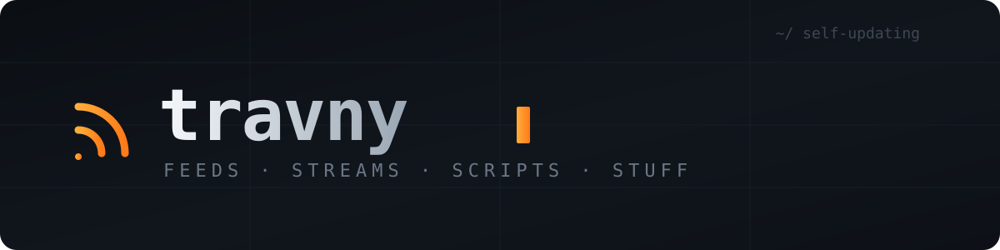
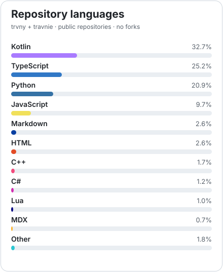
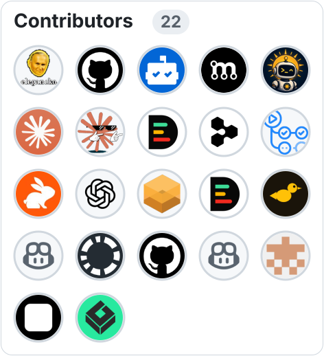

 

consolidation over fragmentation · po kolei, na spokojnie

 

  

  
   

<a href="https://www.star-history.com/?repos=trvny%2Ffeedseek%2Ctravnie%2Ftwojstar%2Ctrvny%2Ftvpi%2Ctravnie%2Fwambridge%2Ctravnie%2Fkanarek&type=date&legend=top-left">
 <picture>
   <source media="(prefers-color-scheme: dark)" srcset="https://api.star-history.com/chart?repos=trvny/feedseek%2Ctravnie/twojstar%2Ctrvny/tvpi%2Ctravnie/wambridge%2Ctravnie/kanarek&type=date&theme=dark&legend=top-left" />
   <source media="(prefers-color-scheme: light)" srcset="https://api.star-history.com/chart?repos=trvny/feedseek%2Ctravnie/twojstar%2Ctrvny/tvpi%2Ctravnie/wambridge%2Ctravnie/kanarek&type=date&legend=top-left" />
   
 </picture>
</a>

# .github
> This repo contains shared community resources that will propagate to all public repositories that don't already have their own resource that fills this purpose. You can learn more about this GitHub feature [here](https://help.github.com/en/articles/creating-a-default-community-health-file-for-your-organization). 

## [Licenses](LICENSE) <picture><source media="(prefers-color-scheme: dark)" srcset="https://github.com/github/github-mcp-server/blob/main/pkg/octicons/icons/law-dark.png"><source media="(prefers-color-scheme: light)" srcset="https://github.com/github/github-mcp-server/blob/main/pkg/octicons/icons/law-light.png"></picture>

Code, workflows, and configuration are licensed under [ISC](LICENSE). Original
content, documentation, and graphics are available under
[CC BY 4.0](docs/LICENSE.CC-BY-4.0). Third-party materials are documented in
[THIRD_PARTY_NOTICES.md](docs/THIRD_PARTY_NOTICES.md).

---
## 💬 Quote from the drawer
<!-- markdownlint-disable MD033 -->
<!--STARTS_HERE_QUOTE_README-->
<i>❝More than 80% of the emails sent daily are spams.❞</i>
<!--ENDS_HERE_QUOTE_README-->
<!-- markdownlint-enable MD033 -->

## 📰 Recently on the air
<!--README_FEED:START-->
- [Trust but Verify: Implementing Frontier AI Policy in California and Beyond](https://carnegieendowment.org/research/2026/11/trust-but-verify-implementing-frontier-ai-policy-in-california-and-beyond)
- [Promises Made, Promises Unmet: The NPP’s Struggle to Reform Sri Lanka](https://carnegieendowment.org/research/2026/11/promises-made-promises-unmet-the-npps-struggle-to-reform-sri-lanka)
- [W Filipowicach zagrają cztery kapele - zakliczyninfo.pl](https://news.google.com/atom/articles/CBMijAFBVV95cUxPOXdxVjVMdHc0YUw2akRlZlJZREw0WUVmeHdvbDNqNUo5cnNRM1ZWUm9aSEJzSUlKNU1hSkF2anlwUm5sTGpzTHN1NG9wZXhhSGJYbHB6RWhUaUxlQ3FOTnlwNmloNnJLNnJnbjVmYzJ6RWFqMGdvZ3VzVjJNQUZ4SU9qUzFINjBIQ25BSQ?oc=5)
- [Product of the Day — A Magical Bag Of Holding Except The Only Thing It Can Hold Is Infinite Fedoras](https://anycrap.shop/product/a-magical-bag-of-holding-except-the-only-thing-it-can-hold-is-infinite-fedoras)
- [Cat Fact of the Day](https://catfact.ninja/)
- [Joke of the Day](https://djtech.net/humor/things_to_think_about.htm)
<!--README_FEED:END-->

## Contributors ✨

This project follows the [all-contributors](https://github.com/all-contributors/all-contributors) specification. Contributions of any kind welcome!
([emoji key](https://allcontributors.org/docs/en/emoji-key)):

<!-- ALL-CONTRIBUTORS-LIST:START - Do not remove or modify this section -->
<!-- prettier-ignore-start -->
<!-- markdownlint-disable -->
<table>
  <tbody>
    <tr>
      <td align="center" valign="top" width="14.29%"><a href="https://github.com/trvny"> <b>trvny</b></a> <a href="https://github.com/trvny/trvny/commits?author=trvny" title="Code">💻</a> <a href="https://github.com/trvny/trvny/commits?author=trvny" title="Documentation">📖</a> <a href="https://github.com/trvny" title="Maintenance">🚧</a></td>
      <td align="center" valign="top" width="14.29%"><a href="https://github.com/apps/codacy-production"> <b>codacy-production[bot]</b></a> <a href="https://github.com/trvny/trvny/commits?author=codacy-production%5Bbot%5D" title="Code">💻</a> <a href="https://github.com/trvny/trvny/pulls?q=is%3Apr+reviewed-by%3Acodacy-production%5Bbot%5D" title="Reviewed Pull Requests">👀</a></td>
      <td align="center" valign="top" width="14.29%"><a href="https://github.com/apps/coderabbitai"> <b>CodeRabbit</b></a> <a href="https://github.com/trvny/trvny/pulls?q=is%3Apr+reviewed-by%3Acoderabbitai%5Bbot%5D" title="Reviewed Pull Requests">👀</a> <a href="https://github.com/trvny/trvny/commits?author=coderabbitai%5Bbot%5D" title="Code">💻</a></td>
      <td align="center" valign="top" width="14.29%"><a href="https://github.com/apps/github-actions"> <b>github-actions[bot]</b></a> <a href="https://github.com/apps/github-actions" title="Infrastructure">🚇</a></td>
      <td align="center" valign="top" width="14.29%"><a href="https://github.com/apps/dependabot"> <b>dependabot[bot]</b></a> <a href="https://github.com/apps/dependabot" title="Maintenance">🚧</a></td>
      <td align="center" valign="top" width="14.29%"><a href="https://github.com/apps/mergify"> <b>mergify[bot]</b></a> <a href="https://github.com/apps/mergify" title="Maintenance">🚧</a></td>
      <td align="center" valign="top" width="14.29%"><a href="https://github.com/apps/gptomek"> <b>gptomek[bot]</b></a> <a href="https://github.com/trvny/trvny/commits?author=gptomek%5Bbot%5D" title="Code">💻</a> <a href="https://github.com/trvny/trvny/commits?author=gptomek%5Bbot%5D" title="Documentation">📖</a></td>
    </tr>
    <tr>
      <td align="center" valign="top" width="14.29%"><a href="https://github.com/claude"> <b>claude</b></a> <a href="https://github.com/trvny/trvny/commits?author=claude" title="Code">💻</a></td>
      <td align="center" valign="top" width="14.29%"><a href="https://github.com/apps/claudiusz69"> <b>claudiusz69[bot]</b></a> <a href="https://github.com/trvny/trvny/pulls?q=is%3Apr+reviewed-by%3Aclaudiusz69%5Bbot%5D" title="Reviewed Pull Requests">👀</a></td>
      <td align="center" valign="top" width="14.29%"><a href="https://github.com/apps/deepsource-autofix"> <b>deepsource-autofix[bot]</b></a> <a href="https://github.com/trvny/trvny/commits?author=deepsource-autofix%5Bbot%5D" title="Code">💻</a></td>
      <td align="center" valign="top" width="14.29%"><a href="https://github.com/apps/devin-ai-integration"> <b>devin-ai-integration[bot]</b></a> <a href="https://github.com/trvny/trvny/pulls?q=is%3Apr+reviewed-by%3Adevin-ai-integration%5Bbot%5D" title="Reviewed Pull Requests">👀</a></td>
      <td align="center" valign="top" width="14.29%"><a href="https://github.com/actions-user"> <b>actions-user</b></a> <a href="https://github.com/actions-user" title="Infrastructure">🚇</a></td>
      <td align="center" valign="top" width="14.29%"><a href="https://github.com/apps/chatgpt-codex-connector"> <b>chatgpt-codex-connector[bot]</b></a> <a href="https://github.com/trvny/trvny/commits?author=chatgpt-codex-connector%5Bbot%5D" title="Code">💻</a> <a href="https://github.com/trvny/trvny/pulls?q=is%3Apr+reviewed-by%3Achatgpt-codex-connector%5Bbot%5D" title="Reviewed Pull Requests">👀</a></td>
      <td align="center" valign="top" width="14.29%"><a href="https://github.com/apps/sourcery-ai"> <b>sourcery-ai[bot]</b></a> <a href="https://github.com/trvny/trvny/pulls?q=is%3Apr+reviewed-by%3Asourcery-ai%5Bbot%5D" title="Reviewed Pull Requests">👀</a></td>
    </tr>
    <tr>
      <td align="center" valign="top" width="14.29%"><a href="https://github.com/apps/deepsource-io"> <b>deepsource-io[bot]</b></a> <a href="https://github.com/trvny/trvny/pulls?q=is%3Apr+reviewed-by%3Adeepsource-io%5Bbot%5D" title="Reviewed Pull Requests">👀</a> <a href="https://github.com/apps/deepsource-io" title="Security">🛡️</a></td>
      <td align="center" valign="top" width="14.29%"><a href="https://github.com/apps/kanarek-companion"> <b>kanarek-companion[bot]</b></a> <a href="https://github.com/trvny/trvny/pulls?q=is%3Apr+reviewed-by%3Akanarek-companion%5Bbot%5D" title="Reviewed Pull Requests">👀</a> <a href="https://github.com/apps/kanarek-companion" title="Infrastructure">🚇</a></td>
      <td align="center" valign="top" width="14.29%"><a href="https://github.com/apps/copilot-pull-request-reviewer"> <b>copilot-pull-request-reviewer[bot]</b></a> <a href="https://github.com/trvny/trvny/pulls?q=is%3Apr+reviewed-by%3Acopilot-pull-request-reviewer%5Bbot%5D" title="Reviewed Pull Requests">👀</a></td>
      <td align="center" valign="top" width="14.29%"><a href="https://github.com/apps/github-advanced-security"> <b>github-advanced-security[bot]</b></a> <a href="https://github.com/apps/github-advanced-security" title="Security">🛡️</a></td>
      <td align="center" valign="top" width="14.29%"><a href="https://github.com/apps/copilot-swe-agent"> <b>copilot-swe-agent[bot]</b></a> <a href="https://github.com/trvny/trvny/commits?author=copilot-swe-agent%5Bbot%5D" title="Code">💻</a></td>
      <td align="center" valign="top" width="14.29%"><a href="https://github.com/kucharz2026-maker"> <b>kucharz2026-maker</b></a> <a href="https://github.com/kucharz2026-maker" title="Ideas &amp; Planning">🤔</a></td>
      <td align="center" valign="top" width="14.29%"><a href="https://github.com/apps/cubic-dev-ai"> <b>cubic-dev-ai[bot]</b></a> <a href="https://github.com/trvny/trvny/pulls?q=is%3Apr+reviewed-by%3Acubic-dev-ai%5Bbot%5D" title="Reviewed Pull Requests">👀</a></td>
    </tr>
    <tr>
      <td align="center" valign="top" width="14.29%"><a href="https://github.com/apps/greptile-apps"> <b>greptile-apps[bot]</b></a> <a href="https://github.com/trvny/trvny/pulls?q=is%3Apr+reviewed-by%3Agreptile-apps%5Bbot%5D" title="Reviewed Pull Requests">👀</a></td>
      <td align="center" valign="top" width="14.29%"><a href="https://github.com/apps/allcontributors"> <b>allcontributors[bot]</b></a> <a href="https://github.com/trvny/trvny/commits?author=allcontributors%5Bbot%5D" title="Documentation">📖</a></td>
      <td align="center" valign="top" width="14.29%"><a href="https://github.com/codex"> <b>codex</b></a> <a href="https://github.com/trvny/trvny/commits?author=codex" title="Code">💻</a></td>
      <td align="center" valign="top" width="14.29%"><a href="https://github.com/apps/ecc-tools"> <b>ecc-tools[bot]</b></a> <a href="https://github.com/trvny/trvny/pulls?q=is%3Apr+reviewed-by%3Aecc-tools%5Bbot%5D" title="Reviewed Pull Requests">👀</a></td>
      <td align="center" valign="top" width="14.29%"><a href="https://github.com/apps/vercel"> <b>vercel[bot]</b></a> <a href="https://github.com/apps/vercel" title="Infrastructure">🚇</a></td>
      <td align="center" valign="top" width="14.29%"><a href="https://github.com/apps/cloudflare-workers-and-pages"> <b>cloudflare-workers-and-pages[bot]</b></a> <a href="https://github.com/apps/cloudflare-workers-and-pages" title="Infrastructure">🚇</a></td>
      <td align="center" valign="top" width="14.29%"><a href="https://github.com/apps/anthropic-code-agent"> <b>Claude[bot]</b></a> <a href="https://github.com/trvny/trvny/commits?author=Claude%5Bbot%5D" title="Code">💻</a></td>
    </tr>
    <tr>
      <td align="center" valign="top" width="14.29%"><a href="https://github.com/gemini-cli"> <b>gemini-cli</b></a> <a href="https://github.com/trvny/trvny/commits?author=gemini-cli" title="Code">💻</a></td>
      <td align="center" valign="top" width="14.29%"><a href="https://github.com/apps/github-project-automation"> <b>github-project-automation[bot]</b></a> <a href="https://github.com/apps/github-project-automation" title="Maintenance">🚧</a></td>
      <td align="center" valign="top" width="14.29%"><a href="https://github.com/apps/context7"> <b>context7[bot]</b></a> <a href="https://github.com/trvny/trvny/commits?author=context7%5Bbot%5D" title="Documentation">📖</a></td>
    </tr>
  </tbody>
</table>

<!-- markdownlint-restore -->
<!-- prettier-ignore-end -->

<!-- ALL-CONTRIBUTORS-LIST:END -->
