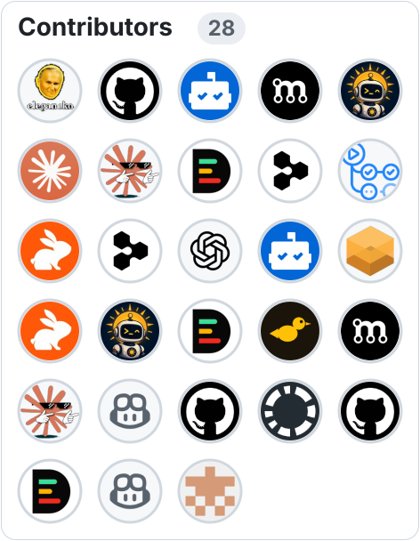

 

consolidation over fragmentation · po kolei, na spokojnie

 

  

  
   

<a href="https://www.star-history.com/?repos=trvny%2Ffeedseek%2Ctravnie%2Ftwojstar%2Ctrvny%2Ftvpi%2Ctravnie%2Fwambridge%2Ctravnie%2Fkanarek&type=date&legend=top-left">
 <picture>
   <source media="(prefers-color-scheme: dark)" srcset="https://api.star-history.com/chart?repos=trvny/feedseek%2Ctravnie/twojstar%2Ctrvny/tvpi%2Ctravnie/wambridge%2Ctravnie/kanarek&type=date&theme=dark&legend=top-left" />
   <source media="(prefers-color-scheme: light)" srcset="https://api.star-history.com/chart?repos=trvny/feedseek%2Ctravnie/twojstar%2Ctrvny/tvpi%2Ctravnie/wambridge%2Ctravnie/kanarek&type=date&legend=top-left" />
   
 </picture>
</a>

# .github
> This repo contains shared community resources that will propagate to all public repositories that don't already have their own resource that fills this purpose. You can learn more about this GitHub feature [here](https://help.github.com/en/articles/creating-a-default-community-health-file-for-your-organization). 

## [Licenses](LICENSE)

Code, workflows, and configuration are licensed under [ISC](LICENSE). Original
content, documentation, and graphics are available under
[CC BY 4.0](docs/LICENSE.CC-BY-4.0). Third-party materials are documented in
[THIRD_PARTY_NOTICES.md](docs/THIRD_PARTY_NOTICES.md).

---
## 💬 Quote from the drawer
<!-- markdownlint-disable MD033 -->
<!--STARTS_HERE_QUOTE_README-->
<i>❝E-Mail was invented before Internet. Shocked!!!! ” I also got shocked after hearing this.”❞</i>
<!--ENDS_HERE_QUOTE_README-->
<!-- markdownlint-enable MD033 -->

## 📰 Recently on the air
<!--README_FEED:START-->
- [Star History Monthly October 2026 | Execution](https://www.star-history.com/blog/execution)
- [Time for Saudi Clarity on Normalization with Israel](https://carnegieendowment.org/research/2026/10/time-for-saudi-clarity-on-normalization-with-israel)
- [mergify unlabeled PR #343 in travnie/twojstar](https://github.com/travnie/twojstar#feedseek-event-18066715698)
- [trvny merged PR #343 in travnie/twojstar](https://github.com/travnie/twojstar#feedseek-event-18066712177)
- [mergify labeled PR #343 in travnie/twojstar](https://github.com/travnie/twojstar#feedseek-event-18066706567)
- [Russia, Ukraine agree on ceasefire in embattled town, to hold peace talks next month](https://www.reuters.com/world/europe/russia-ukraine-agree-ceasefire-embattled-town-hold-peace-talks-next-month-2026-10-23/)
<!--README_FEED:END-->
